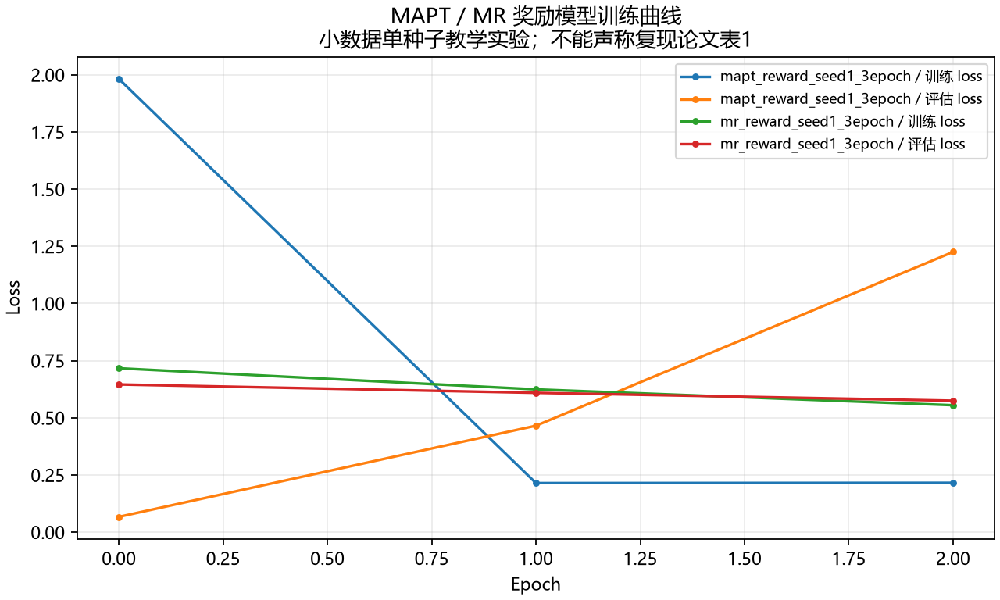
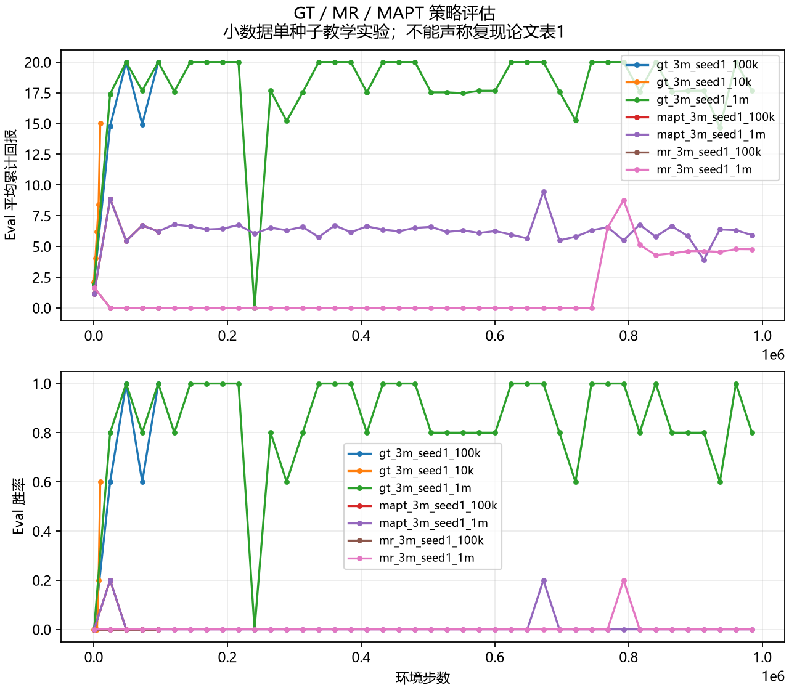

# MAPT 教学实验日志报告

> 这是 3m 小数据、单 seed 的教学实验，不能声称复现论文表1。每次 eval 为 5 局，只反映小样本点估计。报告仅汇总清单中实际存在的日志和标量。

## 数据来源与运行元数据

| ID | 方法 | seed | 预算步数 | 实际训练步数 | stdout末次采样 | 末次评估步数 | 用时（秒） | reward点 | policy点 | 教学数据来源 |
| --- | --- | ---: | ---: | ---: | ---: | ---: | ---: | ---: | ---: | --- |
| gt_3m_seed1_10k | GT | 1 | 10000 | 10020 | 9660 | 9660 | - | 0 | 10 | SMAC 3m 任务真值奖励；不使用偏好数据。 |
| gt_3m_seed1_100k | GT | 1 | 100000 | 99840 | 96480 | 96480 | 209.25 | 0 | 10 | SMAC 3m 任务真值奖励；不使用偏好数据。 |
| mr_3m_seed1_100k | MR | 1 | 100000 | 99840 | 96480 | 96480 | 224.28 | 0 | 10 | results/raw/results/script_teacher_3m_seed1.json 对应脚本教师数据：20 局、22 段、30 对偏好；按 episode 隔离为 24 训练对（episode 0–15）和 6 验证对（episode 16–19）。标签由累计 SMAC 回报比较产生，不是人工反馈或论文数据。 |
| mapt_3m_seed1_100k | MAPT | 1 | 100000 | 99840 | 96480 | 96480 | 240.35 | 0 | 10 | results/raw/results/script_teacher_3m_seed1.json 对应脚本教师数据：20 局、22 段、30 对偏好；按 episode 隔离为 24 训练对（episode 0–15）和 6 验证对（episode 16–19）。标签由累计 SMAC 回报比较产生，不是人工反馈或论文数据。 |
| gt_3m_seed1_1m | GT | 1 | 1000000 | 999840 | 998880 | 984480 | 1895.44 | 0 | 84 | SMAC 3m 任务真值奖励；不使用偏好数据。 |
| mr_3m_seed1_1m | MR | 1 | 1000000 | 999840 | 998880 | 984480 | 2114.13 | 0 | 84 | results/raw/results/script_teacher_3m_seed1.json 对应脚本教师数据：20 局、22 段、30 对偏好；按 episode 隔离为 24 训练对（episode 0–15）和 6 验证对（episode 16–19）。标签由累计 SMAC 回报比较产生，不是人工反馈或论文数据。 |
| mapt_3m_seed1_1m | MAPT | 1 | 1000000 | 999840 | 998880 | 984480 | 2333.58 | 0 | 84 | results/raw/results/script_teacher_3m_seed1.json 对应脚本教师数据：20 局、22 段、30 对偏好；按 episode 隔离为 24 训练对（episode 0–15）和 6 验证对（episode 16–19）。标签由累计 SMAC 回报比较产生，不是人工反馈或论文数据。 |
| mr_reward_seed1_3epoch | MR | 1 | - | - | - | - | - | 6 | 0 | results/raw/results/script_teacher_3m_seed1.json 对应脚本教师数据：20 局、22 段、30 对偏好；按 episode 隔离为 24 训练对（episode 0–15）和 6 验证对（episode 16–19）。标签由累计 SMAC 回报比较产生，不是人工反馈或论文数据。 |
| mapt_reward_seed1_3epoch | MAPT | 1 | - | - | - | - | - | 6 | 0 | results/raw/results/script_teacher_3m_seed1.json 对应脚本教师数据：20 局、22 段、30 对偏好；按 episode 隔离为 24 训练对（episode 0–15）和 6 验证对（episode 16–19）。标签由累计 SMAC 回报比较产生，不是人工反馈或论文数据。 |

## 日志来源

- `gt_3m_seed1_10k`：policy stdout `../results/raw/results/policy_bench/gt_mat_seed1_10k.stdout.log`；标量数据 `../results/raw/gt_3m_seed1_10k_scalars.csv`；10k 对照，8 rollout threads，5 个 eval episodes；对应远端 event 位于 results/policy_bench/results/StarCraft2/3m/mat/gt_mat_seed1_10k/run1/logs/。
- `gt_3m_seed1_100k`：policy stdout `../results/raw/results/policy_100k/gt_mat_seed1_100k.stdout.log`；标量数据 `../results/raw/gt_3m_seed1_100k_scalars.csv`；单 seed 教学基准；8 rollout threads，5 个 eval episodes；实际训练 208 个 rollout，共 99840 环境步。对应远端 event 位于 results/policy_100k/results/StarCraft2/3m/mat/gt_mat_seed1_100k/run1/logs/。
- `mr_3m_seed1_100k`：policy stdout `../results/raw/results/policy_mr_100k/mr_seed1_100k.stdout.log`；标量数据 `../results/raw/mr_3m_seed1_100k_scalars.csv`；奖励 checkpoint 为 MR epoch 2；单 seed 教学实验，8 rollout threads，5 个 eval episodes；实际训练 208 个 rollout，共 99840 环境步。对应远端 event 目录: results/policy_mr_100k/results/StarCraft2/3m/mat/mr_seed1_100k/run1/logs/。
- `mapt_3m_seed1_100k`：policy stdout `../results/raw/results/policy_mapt_100k/mapt_seed1_100k.stdout.log`；标量数据 `../results/raw/mapt_3m_seed1_100k_scalars.csv`；奖励 checkpoint 为 MAPT epoch 0，preference_medium_process_type=cat；单 seed 教学实验，8 rollout threads，5 个 eval episodes；实际训练 208 个 rollout，共 99840 环境步。对应远端 event 位于 results/policy_mapt_100000/results/StarCraft2/3m/mat/mapt_seed1_100000/run1/logs/。
- `gt_3m_seed1_1m`：policy stdout `../results/raw/results/policy_gt_1m/gt_seed1_1m.stdout.log`；标量数据 `../results/raw/results/policy_gt_1m/results/StarCraft2/3m/mat/gt_seed1_1m/run1/logs/summary.json`；1M 配置；2083 updates × 8 rollout threads × episode_length 60 = 999840 actual transitions；stdout 最后周期采样 998880（update 2080/2083）；每次 eval 为 5 局，单 seed。
- `mr_3m_seed1_1m`：policy stdout `../results/raw/results/policy_mr_1m/mr_seed1_1m.stdout.log`；标量数据 `../results/raw/results/policy_mr_1m/results/StarCraft2/3m/mat/mr_seed1_1m/run1/logs/summary.json`；MR (MA-MLP)；1M 配置；2083 updates × 8 rollout threads × episode_length 60 = 999840 actual transitions；stdout 最后周期采样 998880（update 2080/2083）；每次 eval 为 5 局，单 seed。
- `mapt_3m_seed1_1m`：policy stdout `../results/raw/results/policy_mapt_1m/mapt_seed1_1m.stdout.log`；标量数据 `../results/raw/results/policy_mapt_1m/results/StarCraft2/3m/mat/mapt_seed1_1m/run1/logs/summary.json`；1M 配置；2083 updates × 8 rollout threads × episode_length 60 = 999840 actual transitions；stdout 最后周期采样 998880（update 2080/2083）；每次 eval 为 5 局，单 seed。
- `mr_reward_seed1_3epoch`：标量数据 `../results/raw/mr_reward_seed1_scalars.csv`；3 epochs；策略使用 reward_model_2.pt；对应远端 event 目录: results/reward_short/smac/3m/MR/mr_seed1_short/logs/。原始训练 stdout 未留存。
- `mapt_reward_seed1_3epoch`：标量数据 `../results/raw/mapt_reward_seed1_scalars.csv`；3 epochs；策略使用 reward_model_0.pt，medium_process_type=cat；对应远端 event 目录: results/reward_short/smac/3m/MultiPrefTransformerDivide/mapt_seed1_short/logs/。原始训练 stdout 未留存。

## 指标

奖励模型 loss 记录：12 点。策略评估记录：292 点。训练 episode reward 不作为 eval 累计回报。

### 策略末次评估

| ID | 方法 | 预算 | Eval 步数 | 平均累计回报 | 胜率 |
| --- | --- | ---: | ---: | ---: | ---: |
| gt_3m_seed1_100k | GT | 100k | 96480 | 20.0000 | 1.000 |
| gt_3m_seed1_10k | GT | 10k | 9660 | 15.0027 | 0.600 |
| gt_3m_seed1_1m | GT | 1M | 984480 | 17.6658 | 0.800 |
| mapt_3m_seed1_100k | MAPT | 100k | 96480 | 6.2247 | 0.000 |
| mapt_3m_seed1_1m | MAPT | 1M | 984480 | 5.9178 | 0.000 |
| mr_3m_seed1_100k | MR | 100k | 96480 | 0.0000 | 0.000 |
| mr_3m_seed1_1m | MR | 1M | 984480 | 4.7671 | 0.000 |

### 奖励模型末次 loss

| ID | 方法 | epoch | train loss | eval loss |
| --- | --- | ---: | ---: | ---: |
| mapt_reward_seed1_3epoch | MAPT | 2 | 0.21541 | 1.22514 |
| mr_reward_seed1_3epoch | MR | 2 | 0.55488 | 0.57467 |

### 解读限制

100k 与 1M 的末次 eval 都只有单 seed、每次 5 局；这些点估计不能用于判断稳定的性能升降。当前小数据教学实验没有观察到 MAPT 的稳定优势，不能外推为论文结论。

